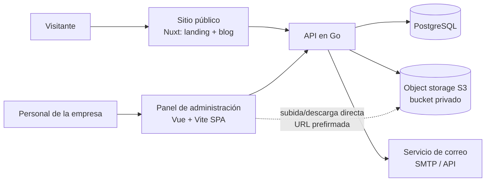

# Análisis del proyecto: sitio web y almacenamiento privado para empresa consultora

> Documento de análisis y diseño preliminar. Las decisiones marcadas como **propuestas** deben validarse con el equipo y con el cliente.

---

## 1. Resumen del proyecto

Una empresa de consultoría y asesoría empresarial solicita:

1. **Landing page** institucional con formulario de contacto.
2. **Blog** que el personal de la empresa pueda gestionar por sí mismo.
3. **Almacenamiento en la nube propio**, de uso exclusivo del personal de la empresa.

**Contexto del equipo:** proyecto escolar en equipo, con roles definidos (estructura tipo SCRUM). El equipo conoce Vue y plantea usar Go en el backend.

**Contexto del cliente:** los redactores del blog están acostumbrados a Word. El cliente no quiere soluciones complicadas de operar.

---

## 2. Requisitos

### 2.1 Requisitos funcionales

| ID | Requisito |
|---|---|
| RF-01 | Landing page pública con información de la empresa y servicios |
| RF-02 | Formulario de contacto con validación, antispam y envío de correo |
| RF-03 | Blog público con listado, artículos individuales y URL con slug |
| RF-04 | Panel de administración con login y roles (administrador, editor, empleado) |
| RF-05 | Edición de artículos con editor enriquecido, borradores, publicación y programación |
| RF-06 | Importación de documentos .docx para convertirlos en artículos |
| RF-07 | Campos SEO por artículo (slug, meta título, meta descripción, imagen de portada) |
| RF-08 | Almacenamiento de archivos privado: carpetas, subir, descargar, renombrar, mover, eliminar |
| RF-09 | Acceso al almacenamiento solo para personal autenticado de la empresa |
| RF-10 | Registro de actividad (quién subió, descargó o eliminó qué) |

### 2.2 Requisitos no funcionales

| ID | Requisito |
|---|---|
| RNF-01 | **Seguridad:** HTTPS, contraseñas con hash (argon2/bcrypt), sesiones con expiración, sanitización de contenido |
| RNF-02 | **SEO:** HTML renderizado para buscadores y vistas previas al compartir (Open Graph), sitemap, datos estructurados |
| RNF-03 | **Escalabilidad del almacenamiento:** no depender del disco de la VPS |
| RNF-04 | **Mantenibilidad:** que la empresa pueda operar el contenido sin programadores |
| RNF-05 | **Rendimiento:** buenos Core Web Vitals en las páginas públicas |
| RNF-06 | **Respaldo y recuperación** de base de datos y archivos |
| RNF-07 | **Costo** contenido y predecible |

---

## 3. Decisiones tomadas

Lo que el equipo ya planteó como base:

| # | Decisión | Estado |
|---|---|---|
| D-01 | El frontend se construirá con un framework basado en **Vue** | Tomada (por el equipo) |
| D-02 | El backend se propondrá en **Go** | Propuesta del autor del análisis al equipo |
| D-03 | El almacenamiento **no** se guardará en el disco de la VPS | Tomada (criterio técnico) |
| D-04 | **No** se publicarán PDF ni .docx directamente como artículos del blog | Tomada (criterio técnico) |
| D-05 | Los artículos se guardarán en **PostgreSQL**, no como archivos `.md` en el servidor | Propuesta firme |

## 4. Propuestas pendientes de validación

Opciones analizadas con una recomendación, que aún requieren confirmación:

| # | Tema | Recomendación actual |
|---|---|---|
| P-01 | Framework del sitio público | Nuxt (alternativas: Astro + Vue, plantillas Go) |
| P-02 | Estructura del panel de administración | SPA Vue + Vite separada (o sección `ssr: false` dentro de Nuxt) |
| P-03 | Almacenamiento | Object storage compatible con S3 + backend Go con URLs prefirmadas |
| P-04 | Editor del blog | Tiptap (WYSIWYG) + importación desde .docx |
| P-05 | Modo de renderizado del blog | SSR con caché |

## 5. Pendientes por definir

Información que falta y que puede cambiar las decisiones anteriores:

- [ ] **Tráfico esperado** del sitio (visitas mensuales aproximadas).
- [ ] **Volumen de archivos** del almacenamiento: tamaño total inicial, crecimiento anual y tamaño máximo por archivo.
- [ ] **Número de usuarios** del almacenamiento y del panel, y qué roles necesitan.
- [ ] **Quiénes redactan el blog** (una persona, varios autores) y si hace falta un flujo de revisión y aprobación.
- [ ] **Qué espera la materia:** un sistema desarrollado a medida o una solución que cumpla los requisitos del cliente. Esto decide entre desarrollo propio y productos listos.
- [ ] **Si la empresa ya usa Google Workspace o Microsoft 365**, lo que cambiaría la conveniencia de integrar Drive/OneDrive.
- [ ] **Dominio y correo:** quién administra el dominio, y de dónde saldrán los correos del formulario.
- [ ] **Presupuesto mensual** de hosting y almacenamiento.
- [ ] **Requisitos legales:** aviso de privacidad y tratamiento de los datos que llegan por el formulario de contacto.
- [ ] **Estado de la infraestructura:** resolver el problema actual del dominio que no apunta a la página alojada en la VPS (Dokploy).
- [ ] **Quién mantendrá el sistema** después de la entrega.

---

## 6. Arquitectura propuesta

### 6.1 Vista general

### 6.2 Componentes

| Componente | Tecnología propuesta | Responsabilidad |
|---|---|---|
| Sitio público | Nuxt (SSR híbrido con caché) | Landing, blog, SEO, formulario de contacto |
| Panel de administración | Vue 3 + Vite + Vue Router + Pinia | Gestión de blog, archivos y usuarios |
| API | Go | Autenticación, lógica de negocio, permisos, generación de URLs prefirmadas |
| Base de datos | PostgreSQL | Usuarios, posts, mensajes de contacto, metadatos de archivos, registro de actividad |
| Almacenamiento | Bucket S3 compatible (R2, B2, Wasabi, S3, etc.) | Archivos privados e imágenes del blog |
| Proxy / despliegue | Dokploy en VPS + proxy inverso con HTTPS | Orquestación de servicios |

### 6.3 Dominios sugeridos

- `www.empresa.com`: sitio público.
- `admin.empresa.com`: panel privado.
- `api.empresa.com`: API (o rutas `/api` detrás de un proxy en el mismo dominio, lo que simplifica cookies y CORS).

### 6.4 Autenticación

- Sesiones por cookie `HttpOnly` y `Secure` emitidas por el backend Go, con expiración.
- Roles: administrador, editor, empleado.
- Protección contra fuerza bruta (límite de intentos) y, opcionalmente, doble factor para administradores.

---

## 7. Almacenamiento privado

### 7.1 Problema

El disco de una VPS es limitado: con muchos archivos se llena, los respaldos se complican y un fallo del servidor puede significar pérdida de datos.

### 7.2 Alternativas evaluadas

| Opción | Ventajas | Desventajas |
|---|---|---|
| **Object storage S3 (propuesta)** | Capacidad prácticamente ilimitada, costo por GB, la empresa es dueña de la cuenta, subida directa sin saturar la VPS | Hay que construir la interfaz de explorador de archivos |
| **Nextcloud autoalojado** | Interfaz, usuarios y compartición ya resueltos; puede usar S3 como respaldo | Otro servicio que mantener y actualizar; poco desarrollo propio |
| **Drive / OneDrive / Dropbox vía API** | La empresa podría ya usarlos | OAuth, tokens, cuotas y límites de API; dependencia de cuentas; más complejidad, no menos |
| **Volumen adicional en la VPS** | Simple para volúmenes pequeños | Atado a un solo servidor; respaldos a cargo del equipo |

### 7.3 Diseño propuesto

- Bucket **privado**: ningún archivo es público.
- El navegador solicita a la API una **URL prefirmada temporal** para subir o descargar; el archivo viaja directo entre el navegador y el bucket, sin pasar por la VPS.
- Las carpetas se representan con **prefijos**; los metadatos (nombre, ruta, dueño, tamaño, fecha) se guardan en PostgreSQL.
- Los permisos se validan en la API antes de emitir cada URL.
- Subida por partes (multipart) para archivos grandes; en el cliente, una librería como Uppy da barra de progreso y reintentos.
- Registro de actividad para auditoría.
- Límites de tamaño y de tipo de archivo; cuotas por usuario si se necesitan.
- Librerías Go: `aws-sdk-go-v2` o `minio-go`.

### 7.4 Costo

Es un servicio de pago por uso, con costos que varían según el proveedor y cambian con el tiempo. **Pendiente:** cotizar con los precios vigentes de cada proveedor una vez conocido el volumen esperado.

---

## 8. Frontend

### 8.1 Por qué no una SPA pura de Vue

Una SPA con Vue + Vite depende de JavaScript para mostrar contenido. Google la indexa con más lentitud y menos fiabilidad, y los rastreadores de WhatsApp, LinkedIn o Facebook no ejecutan JavaScript, por lo que al compartir un artículo no aparecería una vista previa correcta.

### 8.2 Opciones evaluadas para el sitio público

| Opción | Descripción | Pros | Contras |
|---|---|---|---|
| **Nuxt** | Vue con SSR, SSG o híbrido por ruta | Mismo ecosistema Vue; SEO resuelto; un solo framework para todo | Proceso Node en producción si se usa SSR |
| **Astro + islas Vue** | HTML casi sin JS, Vue solo donde hace falta | Mejor rendimiento; excelente para contenido | Framework adicional que aprender; el panel es mejor separado |
| **Vue + vite-ssg / Vike** | Prerenderizado en el build | Ligero | El contenido dinámico exige reconstruir |
| **Plantillas HTML en Go** | El backend Go entrega el HTML | Un solo proceso y binario; mínimo consumo | Menos comodidad frontend; sitemap, metas e imágenes a mano |
| **Servicio de prerender de terceros** | Un tercero sirve HTML a los bots | No cambia el código | Parche, costo extra y fragilidad (descartado) |

### 8.3 Comparación Nuxt vs. Astro + Vue

| Criterio | Nuxt | Astro + Vue |
|---|---|---|
| Curva de aprendizaje | Baja (es Vue con convenciones) | Media (Astro + Vue) |
| SEO | Muy bueno | Excelente |
| Rendimiento público | Bueno (hidrata toda la página) | Mejor (JS solo donde hay interactividad) |
| Panel de administración | En el mismo proyecto o separado | Mejor separado |
| Cohesión del stack | Un solo framework | Dos formas de trabajo |
| Ecosistema Vue | Nativo | Con algo de fricción |

**Recomendación:** Nuxt para el sitio público, por la productividad del equipo y la cohesión del stack. Las diferencias de rendimiento frente a Astro son poco perceptibles para el tráfico esperado de una consultora.

### 8.4 Carga del servidor: Nuxt vs. plantillas Go

| | Nuxt SSR | Nuxt estático | Plantillas Go |
|---|---|---|---|
| Procesos en producción | Go + Node | Solo Go (+ servidor de estáticos) | Solo Go |
| Consumo de memoria | Mayor | Bajo | Muy bajo |
| Publicar un artículo | Inmediato | Requiere reconstruir | Inmediato |
| Comodidad de desarrollo | Alta | Alta | Media |

Con SSR y caché (`routeRules`, `swr`/`isr`), cada artículo se renderiza una vez y se sirve cacheado, por lo que la carga real sobre Node es baja. El cuello de botella más probable será la base de datos o el almacenamiento, no Node.

### 8.5 Panel de administración

- SPA de **Vue 3 + Vite** con Vue Router y Pinia, sin SSR ni SEO (está detrás de login).
- Puede desplegarse como proyecto separado (`admin.empresa.com`) o como sección con `ssr: false` dentro de Nuxt si se prefiere un solo repositorio.
- Astro podría alojarlo como isla Vue (`client:only`), pero no aporta ventaja para este caso.

### 8.6 Requisitos de SEO

- Título y meta descripción únicos por página; etiquetas Open Graph y Twitter.
- `sitemap.xml` (el del blog generado desde la API) y `robots.txt`.
- URL limpias con slug y etiqueta canonical.
- Datos estructurados JSON-LD (`Organization` en el landing, `Article` en el blog).
- Imágenes optimizadas (WebP/AVIF, tamaños responsivos, lazy loading).
- HTML semántico: un solo `h1`, jerarquía de títulos, textos alternativos.
- Alta del sitio en Google Search Console.

### 8.7 Formulario de contacto

Validación en el backend, protección antispam (honeypot o captcha), límite de envíos por IP y envío de correo mediante SMTP o un servicio transaccional. Los mensajes se guardan también en PostgreSQL.

---

## 9. Editor del blog

### 9.1 Contexto

Los redactores son personal de la empresa acostumbrado a Word. El editor debe sentirse familiar y publicar HTML limpio.

### 9.2 Dónde guardar el contenido

| Opción | Evaluación |
|---|---|
| Archivos `.md` en repo o disco | Solo adecuado si escribe el equipo técnico. Obliga a usar Git y a desplegar; sin borradores ni roles |
| **PostgreSQL (propuesta)** | Integrado con la API, roles, borradores, programación y respaldos |

**Modelo de post sugerido:** `id`, `titulo`, `slug`, `cuerpo`, `extracto`, `imagen_portada`, `meta_titulo`, `meta_descripcion`, `estado` (borrador/publicado/programado), `fecha_publicacion`, `autor_id`, `creado_en`, `actualizado_en`.

### 9.3 Opciones de editor

| Opción | Almacena | Pros | Contras |
|---|---|---|---|
| Markdown + vista previa (Milkdown, Toast UI, `md-editor-v3`) | Markdown | Formato limpio y portable; seguro | Markdown no es natural para usuarios de Word |
| **WYSIWYG con Tiptap (propuesta)** | HTML o JSON | Experiencia tipo Word; extensible | Obliga a sanitizar el HTML |
| Por bloques (Editor.js, BlockNote) | JSON | Estructurado y cómodo | Requiere renderizador por tipo de bloque |
| CMS headless (Strapi, Directus, Ghost, Payload) | Según el CMS | Casi no hay que programar el panel | Otra pieza que mantener; menos desarrollo propio |

### 9.4 PDF y .docx

- **No se publican directamente** como artículos: el PDF no es contenido web adaptable ni buen material SEO, y el navegador no renderiza .docx.
- Sí pueden ofrecerse como **archivos descargables** adjuntos a un artículo.

### 9.5 Flujo propuesto

1. **Tiptap** como editor principal, con pegado limpio desde Word.
2. Botón **«Importar desde Word (.docx)»**: el backend convierte el archivo a HTML con **Mammoth** o **Pandoc**, extrae las imágenes al bucket y carga el resultado en el editor para revisión humana.
3. **Sanitización del HTML en Go** (`bluemonday`) antes de guardar.
4. Vista previa, autoguardado de borradores y, si el alcance lo permite, historial de versiones.
5. Subida de imágenes por arrastrar y soltar usando URLs prefirmadas.
6. Guía breve de redacción para la empresa (usar estilos «Título 1/2» de Word, no tamaños manuales), lo que mejora mucho la conversión.

---

## 10. Alternativas de enfoque global

| Enfoque | Descripción | Esfuerzo de desarrollo | Mantenimiento por el cliente | Personalización |
|---|---|---|---|---|
| **A. A medida con Go + Vue/Nuxt** | Todo desarrollado por el equipo | Alto | Medio (depende de quien mantenga el código) | Máxima |
| **B. A medida con Laravel (PHP)** | Mismo concepto con otro stack; trae autenticación, S3 y paneles como Filament | Medio | Medio | Alta |
| **C. Productos listos (WordPress + Nextcloud)** | Sin desarrollo a medida | Bajo | Alto (actualizaciones y seguridad de plugins) | Limitada |

Notas:

- **WordPress** cubre blog, editor, roles y SEO con plugins, pero es el CMS más atacado de internet y exige mantener plugins al día. Encaja mal con el almacenamiento privado.
- **Cambiar de Go a PHP** no tiene justificación técnica si el equipo ya domina Go y Vue; añadiría riesgo a mitad del análisis.
- La elección entre A, B y C depende de lo que la materia espera entregar (ver pendientes).

---

## 11. Riesgos

| # | Riesgo | Probabilidad | Impacto | Mitigación |
|---|---|---|---|---|
| R-01 | **Alcance excesivo:** el explorador de archivos y el panel del blog son proyectos grandes dentro del proyecto | Alta | Alto | Priorizar con MVP en sprints; considerar Nextcloud o un CMS headless para partes no críticas |
| R-02 | **XSS por contenido del editor** | Media | Alto | Sanitizar siempre en el backend con `bluemonday`; no confiar en el editor |
| R-03 | **Fuga de archivos privados** (bucket mal configurado, URL prefirmadas con vigencia larga) | Baja | Muy alto | Bucket privado, URL de corta duración, validación de permisos en la API, revisión de configuración |
| R-04 | **Conversión .docx imperfecta** (tablas complejas, imágenes flotantes) | Alta | Bajo | Revisión previa obligatoria, guía de redacción, la importación es una ayuda, no el flujo único |
| R-05 | **Costos de almacenamiento no previstos** (crecimiento, tráfico de salida) | Media | Medio | Cotizar con volumen real, definir cuotas y alertas, elegir proveedor con salida sin costo o bajo |
| R-06 | **Pérdida de datos** (sin respaldos) | Media | Muy alto | Respaldos automáticos de PostgreSQL, versionado o réplica del bucket, probar la restauración |
| R-07 | **Mal SEO** si se publica como SPA pura | Media | Alto | Usar Nuxt (SSR/híbrido) para el sitio público |
| R-08 | **Complejidad operativa** (Go + Node + Postgres + bucket) para una VPS pequeña | Media | Medio | Dokploy para orquestar, caché en Nuxt, monitoreo básico, o plantillas Go si se prioriza simplicidad |
| R-09 | **Problemas de dominio, DNS o HTTPS** (hoy el dominio no resuelve a la página alojada) | Alta (ya ocurre) | Medio | Resolver pronto la configuración DNS y del proxy; documentar el procedimiento |
| R-10 | **Abuso del formulario de contacto** (spam) | Alta | Bajo | Honeypot o captcha, límite de envíos, validación |
| R-11 | **Seguridad de cuentas** (contraseñas débiles, sesiones robadas) | Media | Alto | Hash robusto, cookies `HttpOnly`, expiración, límite de intentos, 2FA para administradores |
| R-12 | **Dependencia de pocas personas del equipo** (conocimiento concentrado) | Media | Medio | Documentación, revisión de código cruzada, rotación de tareas |
| R-13 | **Falta de mantenimiento tras la entrega** | Media | Medio | Definir responsable, entregar manual de operación y guía de actualizaciones |
| R-14 | **Cumplimiento de privacidad** de los datos recibidos por el formulario | Media | Medio | Aviso de privacidad, guardar solo lo necesario, acceso restringido |

---

## 12. Plan sugerido por fases

1. **Fase 0: definición.** Cerrar los pendientes de la sección 5 con el cliente y el docente; validar el enfoque (A, B o C).
2. **Fase 1: base.** Repositorios, entorno de despliegue, dominio y HTTPS, base de datos, esquema inicial.
3. **Fase 2: núcleo de la API.** Autenticación, roles, usuarios.
4. **Fase 3: sitio público.** Landing, formulario de contacto, SEO base.
5. **Fase 4: blog.** Modelo de posts, API, vistas públicas y panel con editor Tiptap, imágenes y campos SEO.
6. **Fase 5: almacenamiento.** Integración S3, URL prefirmadas, explorador de archivos, permisos, registro de actividad.
7. **Fase 6: importación .docx y refinamientos.** Mammoth/Pandoc, vista previa, autoguardado.
8. **Fase 7: endurecimiento y entrega.** Respaldos, pruebas de seguridad, rendimiento, documentación y capacitación al cliente.

---

## 13. Criterios para la matriz de decisión

Para justificar las elecciones en el documento final, puntuar cada alternativa (1 a 5) en:

- Esfuerzo de desarrollo
- Curva de aprendizaje del equipo
- SEO
- Rendimiento
- Seguridad
- Mantenimiento por el cliente
- Costo mensual
- Escalabilidad
- Personalización

---

## 14. Resumen ejecutivo de la propuesta

- **Frontend público:** Nuxt con renderizado híbrido y caché (SEO y Vue).
- **Panel de administración:** SPA Vue + Vite separada, con Tiptap para el blog.
- **Backend:** API en Go con sesiones por cookie y roles.
- **Datos:** PostgreSQL para usuarios, posts, mensajes y metadatos de archivos.
- **Archivos:** bucket S3 privado con URL prefirmadas; Nextcloud como alternativa si se prioriza rapidez sobre personalización.
- **Blog:** contenido en base de datos, editor tipo Word e importación desde .docx con revisión.
- **Pendiente crítico:** definir qué espera la materia, el tráfico, el volumen de archivos y quién redacta y mantiene.
